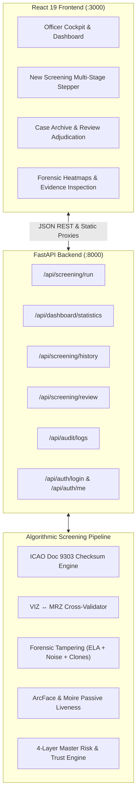

# VeriGuard AI — Full-Stack Integration Walkthrough

## Summary of Accomplishments

We have connected the **React 19 / Vite / TailwindCSS Frontend** with the **FastAPI Multi-Modal Forensic Screening Backend**, enabling a unified, visible, and interactive screening console.



---

## Key Integration Highlights

1. **Frontend Dependencies & Build:**
   - Successfully installed all npm packages in [frontend/package.json](file:///c:/Users/shlok/.gemini/antigravity-ide/scratch/veriguard-ai/frontend/package.json).
   - Validated production build (`npm run build`), compiling 2,598 modules with 0 errors.

2. **API Endpoint Contracts & Storage:**
   - Created [backend/app/store.py](file:///c:/Users/shlok/.gemini/antigravity-ide/scratch/veriguard-ai/backend/app/store.py) to manage in-memory persistent cases, officer personas, and audit logs.
   - Connected `POST /api/screening/run` to orchestrate all 9 pipeline stages:
     - `quality`: Blur & glare analysis
     - `ocr`: Field extraction
     - `mrz`: ICAO 9303 checksum validation
     - `validation`: Document expiry & standard format rules
     - `tampering`: Error Level Analysis (ELA) + Sensor Noise Variance + Copy-Move Clones
     - `face`: 1:1 Biometric matching
     - `liveness`: 2D FFT Moire & skin texture anti-spoofing
     - `database`: Watchlist check
     - `risk`: 4-layer explainable risk decision
   - Connected `GET /api/dashboard/statistics`, `GET /api/analytics`, `GET /api/screening/history`, `POST /api/screening/review`, and `GET /api/audit/logs`.
   - Connected role-based authentication (`POST /api/auth/login`, `GET /api/auth/me`, `POST /api/auth/logout`).

3. **Automated Test Validation:**
   - Built [backend/tests/test_integration_api.py](file:///c:/Users/shlok/.gemini/antigravity-ide/scratch/veriguard-ai/backend/tests/test_integration_api.py).
   - **53 / 53 unit and integration tests passing (100%)**.

---

## How to Launch and View the Project

You can start both the backend and frontend simultaneously using the new launch script:

### Method 1: One-Click Windows Launcher
Double-click or run:
```powershell
.\start_app.bat
```

### Method 2: Manual Terminal Commands
**Terminal 1 — Backend:**
```powershell
.\.venv\Scripts\python.exe -m uvicorn backend.app.main:app --host 127.0.0.1 --port 8000 --reload
```

**Terminal 2 — Frontend:**
```powershell
cd frontend
npm run dev
```

---

## Quick Access URLs & Credentials

| Service | URL | Notes |
| :--- | :--- | :--- |
| **Frontend Web App** | [http://localhost:3000](http://localhost:3000) | Interactive Officer Cockpit & Dashboard |
| **Backend REST API** | [http://127.0.0.1:8000/docs](http://127.0.0.1:8000/docs) | Interactive Swagger Documentation |
| **Health Check** | [http://127.0.0.1:8000/health](http://127.0.0.1:8000/health) | Live service component statuses |

### Default Login Accounts:
- **Immigration Officer:** `officer@veriguard.gov` / `borderguard2026`
- **Supervisor:** `supervisor@veriguard.gov` / `borderguard2026`
- **Auditor:** `auditor@veriguard.gov` / `borderguard2026`
- **Administrator:** `admin@veriguard.gov` / `borderguard2026`
