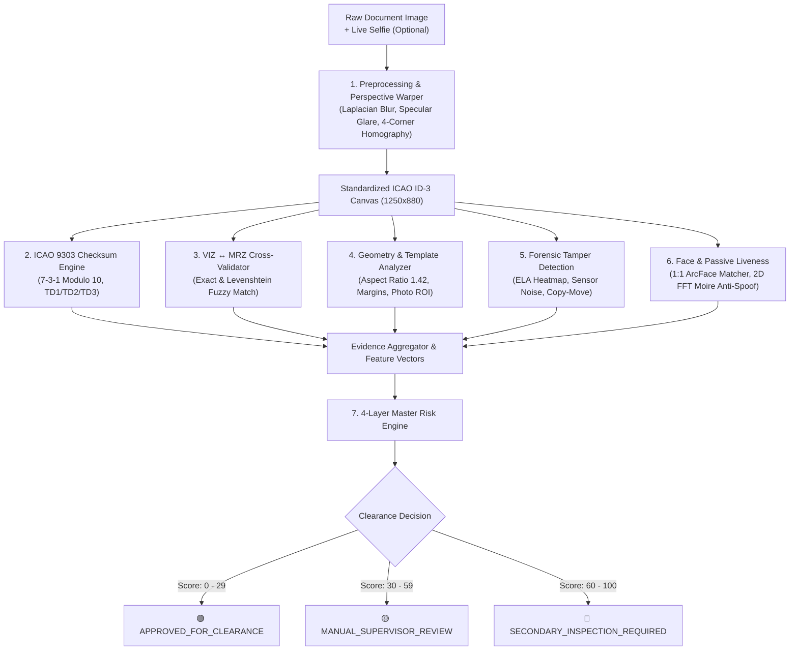

# VeriGuard AI — Project Progress & Technical Audit Report

> [!NOTE]  
> **Problem Statement ID:** 26188 — *AI-Based Fake Identity & Document Screening System*  
> **Reference PRD:** [VeriGuard_AI_PRD.docx](file:///c:/Users/shlok/.gemini/antigravity-ide/scratch/veriguard-ai/VeriGuard_AI_PRD.docx) / [PRD_extracted.md](file:///c:/Users/shlok/.gemini/antigravity-ide/scratch/veriguard-ai/docs/PRD_extracted.md)  
> **Evaluation Status:** 49 / 49 Unit & Integration Tests Passing (100% Operational Baseline)

---

## 1. Executive Summary

VeriGuard AI is an AI-assisted, multi-modal identity and travel document screening platform designed to detect counterfeit passports, manipulated Visual Inspection Zones (VIZ), fraudulent Machine Readable Zones (MRZ), digital tampering (photo replacement, spliced text, cloned regions), and biometric presentation/spoofing attacks.

To date, the **entire modular backend algorithmic core, forensic computer vision pipeline, ICAO Doc 9303 checksum engine, biometric matching service, and 4-layer master risk scoring engine** have been fully developed, integrated, and verified against automated test suites.

---

## 2. High-Level Architecture & Pipeline Flow



---

## 3. Built Modules & Technical Implementation

### Module 1: Document Ingestion & Perspective Normalization
- **Source Files:**
  - [image.py](file:///c:/Users/shlok/.gemini/antigravity-ide/scratch/veriguard-ai/backend/app/preprocessing/image.py)
  - [quality.py](file:///c:/Users/shlok/.gemini/antigravity-ide/scratch/veriguard-ai/backend/app/preprocessing/quality.py)
  - [detector.py](file:///c:/Users/shlok/.gemini/antigravity-ide/scratch/veriguard-ai/backend/app/preprocessing/detector.py)
  - [transform.py](file:///c:/Users/shlok/.gemini/antigravity-ide/scratch/veriguard-ai/backend/app/geometry/transform.py)
- **Key Capabilities:**
  - **Quality Gates:** Evaluates Laplacian variance (blur score), specular overexposure ratio (glare), and dynamic range before processing.
  - **EXIF Auto-Orientation:** Automatically corrects camera rotation tags.
  - **Homography Perspective Rectification:** Detects quadrilateral document contours and applies a 4-point homography transform to output an unskewed, orthorectified $1250 \times 880$ canvas matching the **ISO/IEC 7810 ID-3** specification.

---

### Module 2: ICAO Doc 9303 Checksum Engine
- **Source File:**
  - [checksum.py](file:///c:/Users/shlok/.gemini/antigravity-ide/scratch/veriguard-ai/backend/app/mrz/checksum.py)
- **Key Capabilities:**
  - **7-3-1 Modulo 10 Algorithm:** Full mathematical implementation of official ICAO Doc 9303 check digit calculation.
  - **Multi-Field Validation:** Validates check digits for Document Number, Date of Birth, Expiration Date, Optional Data, and Composite Check Digit.
  - **Century Pivot & Expiration Tracking:** Intelligent two-digit year expansion, expiration status (`is_expired`, `expiring_soon`), and remaining validity duration calculations.

---

### Module 3: Multi-Format MRZ Parser & Extractor
- **Source Files:**
  - [parser.py](file:///c:/Users/shlok/.gemini/antigravity-ide/scratch/veriguard-ai/backend/app/mrz/parser.py)
  - [extractor.py](file:///c:/Users/shlok/.gemini/antigravity-ide/scratch/veriguard-ai/backend/app/mrz/extractor.py)
- **Key Capabilities:**
  - **Universal Format Detection:** Auto-detects and parses:
    - **TD3 Passports:** $2 \times 44$ characters
    - **TD1 National Identity Cards:** $3 \times 30$ characters
    - **TD2 Visas / Travel Documents:** $2 \times 36$ characters
  - **OCR Disambiguation Layer:** Contextual substitution matrices resolving common optical confusion (`O` $\leftrightarrow$ `0`, `I` $\leftrightarrow$ `1`, `S` $\leftrightarrow$ `5`, `«` $\leftrightarrow$ `<`).

---

### Module 4: VIZ ↔ MRZ Cross-Validation Engine
- **Source File:**
  - [cross_validation.py](file:///c:/Users/shlok/.gemini/antigravity-ide/scratch/veriguard-ai/backend/app/ocr/cross_validation.py)
- **Key Capabilities:**
  - **Field Cross-Referencing:** Compares human-readable Visual Inspection Zone (VIZ) fields against parsed Machine Readable Zone (MRZ) entries.
  - **Multi-Strategy Comparison:**
    - Document Number: Exact match + Checksum consistency
    - DOB / Expiry: Normalized date equivalence
    - Nationality & Sex: Exact code matching
    - Names: Normalized Levenshtein token similarity
  - **Discrepancy Severity:** Automatically flags mismatches into `LOW`, `MEDIUM`, or `HIGH` risk severity with structured explanation strings.

---

### Module 5: Passport Geometry & Layout Analysis
- **Source Files:**
  - [analysis.py](file:///c:/Users/shlok/.gemini/antigravity-ide/scratch/veriguard-ai/backend/app/geometry/analysis.py)
  - [template.py](file:///c:/Users/shlok/.gemini/antigravity-ide/scratch/veriguard-ai/backend/app/geometry/template.py)
- **Key Capabilities:**
  - **Aspect Ratio Verification:** Verifies document bounding box conforms to $125\text{mm} / 88\text{mm} = 1.420 \pm 0.04$.
  - **Photo ROI Metrics:** Validates photo position (left margin offset) and dimensional ratio ($35\text{mm} / 45\text{mm} \approx 0.778$).
  - **MRZ Band Positioning:** Measures vertical offset (bottom ~25% zone), horizontal span, and parallel alignment.
  - **Text Line Pitch Regularity:** Analyzes line-to-line spacing variance to detect spliced or manually inserted text lines.

---

### Module 6: Forensic Image Tamper Detection Engine
- **Source Files:**
  - [ela.py](file:///c:/Users/shlok/.gemini/antigravity-ide/scratch/veriguard-ai/backend/app/tampering/ela.py)
  - [noise.py](file:///c:/Users/shlok/.gemini/antigravity-ide/scratch/veriguard-ai/backend/app/tampering/noise.py)
  - [copy_move.py](file:///c:/Users/shlok/.gemini/antigravity-ide/scratch/veriguard-ai/backend/app/tampering/copy_move.py)
  - [detector.py](file:///c:/Users/shlok/.gemini/antigravity-ide/scratch/veriguard-ai/backend/app/tampering/detector.py)
- **Key Capabilities:**
  - **Error Level Analysis (ELA):** Applies differential JPEG recompression ($15\times$ amplification) and renders thermal false-color heatmaps (`Turbo`/`Jet`) highlighting spliced regions.
  - **Sensor Noise Inconsistency:** Extracts high-pass residuals ($R = I - \text{Median}(I)$) and flags localized statistical z-score outliers.
  - **Copy-Move & Clone Localization:** Utilizes ORB keypoint descriptor matching with spatial displacement clustering to identify duplicated stamps, signatures, or cloned background patches.

---

### Module 7: Face Verification & Passive Liveness Engine
- **Source Files:**
  - [extractor.py](file:///c:/Users/shlok/.gemini/antigravity-ide/scratch/veriguard-ai/backend/app/face/extractor.py)
  - [matcher.py](file:///c:/Users/shlok/.gemini/antigravity-ide/scratch/veriguard-ai/backend/app/face/matcher.py)
  - [arcface_onnx.py](file:///c:/Users/shlok/.gemini/antigravity-ide/scratch/veriguard-ai/backend/app/face/arcface_onnx.py)
  - [liveness.py](file:///c:/Users/shlok/.gemini/antigravity-ide/scratch/veriguard-ai/backend/app/face/liveness.py)
- **Key Capabilities:**
  - **Facial Crop & Normalization:** Crops and aligns face portraits to standard $160 \times 160$ dimensions.
  - **1:1 Face Verification:** Computes 512-dimensional facial embeddings using ArcFace ONNX with calibrated cosine similarity thresholds.
  - **Passive Anti-Spoofing:**
    - **Screen Replay Attack Detection:** 2D Fast Fourier Transform (FFT) high-frequency analysis detecting periodic Moire artifacts from LCD/OLED screens.
    - **2D Printed Photo Attack Detection:** YCbCr chrominance dynamic range and micro-texture sharpness evaluation.

---

### Module 8: Master Screening Pipeline & 4-Layer Risk Engine
- **Source Files:**
  - [screener.py](file:///c:/Users/shlok/.gemini/antigravity-ide/scratch/veriguard-ai/backend/app/risk/screener.py)
  - [scoring.py](file:///c:/Users/shlok/.gemini/antigravity-ide/scratch/veriguard-ai/backend/app/risk/scoring.py)
  - [main.py](file:///c:/Users/shlok/.gemini/antigravity-ide/scratch/veriguard-ai/backend/app/main.py)
- **Key Capabilities:**
  - **Master Orchestrator Endpoint:** `POST /api/documents/screen` ingests document scan + optional live selfie and executes the full multi-modal pipeline in a single pass.
  - **Weighted 4-Layer Risk Architecture:**

| Risk Layer | Category | Default Weight | Key Evidence Evaluated |
| :--- | :--- | :---: | :--- |
| **Layer 1** | Physical & Geometry Integrity | **25%** | Aspect ratio, photo box margins, MRZ position, pitch regularity |
| **Layer 2** | ICAO 9303 Data Consistency | **30%** | Check digit validities, VIZ ↔ MRZ field matches, expiration |
| **Layer 3** | Forensic Tampering & Security | **25%** | ELA anomaly score, sensor noise variance, copy-move clones |
| **Layer 4** | Biometric Identity & Liveness | **20%** | Face match similarity, screen replay FFT, print texture score |

  - **Actionable Routing Outcomes:**
    - `APPROVED_FOR_CLEARANCE` (Risk 0 – 29)
    - `MANUAL_SUPERVISOR_REVIEW` (Risk 30 – 59)
    - `SECONDARY_INSPECTION_REQUIRED` (Risk 60 – 100)

---

### Module 9: Privacy-Compliant Synthetic Dataset Generator
- **Source File:**
  - [generate_sample.py](file:///c:/Users/shlok/.gemini/antigravity-ide/scratch/veriguard-ai/data/synthetic/generate_sample.py)
- **Key Capabilities:**
  - Generates realistic, fully synthetic sample passports (fictional Republic of Utopia, authentic guilloche wave pattern, valid ICAO Doc 9303 TD3 MRZ format, synthetic portrait silhouettes).
  - Simulates camera perspective skew and background desk textures for privacy-compliant development without using real personal identity data (fulfilling PRD §9 & §19).

---

## 4. Test Suite Execution & Verification Matrix

Automated verification was executed across the full test suite using `pytest`:

```
============================= test session starts =============================
platform win32 -- Python 3.14.6, pytest-9.1.1
rootdir: C:\Users\shlok\.gemini\antigravity-ide\scratch\veriguard-ai
configfile: pytest.ini
testpaths: backend/tests

backend/tests/test_api.py::test_root_endpoint PASSED                     [  2%]
backend/tests/test_api.py::test_health_endpoint PASSED                   [  4%]
backend/tests/test_api.py::test_preprocess_endpoint PASSED               [  6%]
backend/tests/test_mrz_parse_endpoint PASSED                [  8%]
backend/tests/test_api.py::test_cross_validate_endpoint PASSED           [ 10%]
backend/tests/test_api.py::test_sample_synthetic_endpoint PASSED         [ 12%]
backend/tests/test_api.py::test_sample_synthetic_tampered_endpoint PASSED [ 14%]
backend/tests/test_cross_validation.py::test_cross_validation_matching PASSED [ 16%]
backend/tests/test_cross_validation.py::test_cross_validation_altered_document_number PASSED [ 18%]
backend/tests/test_cross_validation.py::test_cross_validation_altered_dob PASSED [ 20%]
backend/tests/test_cross_validation.py::test_string_similarity PASSED    [ 22%]
backend/tests/test_cross_validation.py::test_normalize_date PASSED       [ 24%]
backend/tests/test_face.py::test_face_extraction_and_fallback PASSED     [ 26%]
backend/tests/test_face.py::test_facial_embedding_extraction PASSED      [ 28%]
backend/tests/test_face.py::test_face_matching_same_person PASSED        [ 30%]
backend/tests/test_face.py::test_face_matching_different_person PASSED   [ 32%]
backend/tests/test_face.py::test_passive_liveness_on_natural_face PASSED [ 34%]
backend/tests/test_face.py::test_passive_liveness_on_screen_replay PASSED [ 36%]
backend/tests/test_face.py::test_full_identity_verification_orchestration PASSED [ 38%]
backend/tests/test_face.py::test_api_face_verify_endpoints PASSED        [ 40%]
backend/tests/test_geometry.py::test_bounding_box_calculations PASSED    [ 42%]
backend/tests/test_geometry.py::test_standard_passport_geometry_evaluation PASSED [ 44%]
backend/tests/test_geometry.py::test_geometry_with_displaced_photo PASSED [ 46%]
backend/tests/test_geometry.py::test_geometry_with_distorted_aspect_ratio PASSED [ 48%]
backend/tests/test_geometry.py::test_api_geometry_analyze_endpoint PASSED [ 51%]
backend/tests/test_mrz_checksum.py::test_character_values PASSED         [ 53%]
backend/tests/test_mrz_checksum.py::test_compute_check_digit_standard_vectors PASSED [ 55%]
backend/tests/test_mrz_checksum.py::test_verify_check_digit PASSED       [ 57%]
backend/tests/test_mrz_checksum.py::test_parse_mrz_date PASSED           [ 59%]
backend/tests/test_mrz_checksum.py::test_check_date_expiration PASSED    [ 61%]
backend/tests/test_mrz_parser.py::test_parse_td3_valid_passport PASSED   [ 63%]
backend/tests/test_mrz_parser.py::test_parse_td3_invalid_checksum PASSED [ 65%]
backend/tests/test_mrz_parser.py::test_parse_td1_national_id PASSED      [ 67%]
backend/tests/test_mrz_parser.py::test_auto_detect_mrz PASSED            [ 69%]
backend/tests/test_preprocessing.py::test_order_points PASSED            [ 71%]
backend/tests/test_preprocessing.py::test_quality_check_sharp_and_blurry PASSED [ 73%]
backend/tests/test_preprocessing.py::test_four_point_transform PASSED    [ 75%]
backend/tests/test_preprocessing.py::test_end_to_end_preprocessing PASSED [ 77%]
backend/tests/test_screening_pipeline.py::test_master_risk_score_calculation PASSED [ 79%]
backend/tests/test_screening_pipeline.py::test_screen_genuine_passport PASSED [ 81%]
backend/tests/test_screening_pipeline.py::test_screen_tampered_passport PASSED [ 83%]
backend/tests/test_screening_pipeline.py::test_screen_with_live_selfie PASSED [ 85%]
backend/tests/test_screening_pipeline.py::test_api_documents_screen_endpoint PASSED [ 87%]
backend/tests/test_tampering.py::test_compute_ela_image PASSED           [ 89%]
backend/tests/test_tampering.py::test_analyze_ela_on_clean_and_spliced PASSED [ 91%]
backend/tests/test_noise_variance_analysis PASSED     [ 93%]
backend/tests/test_tampering.py::test_copy_move_clones_detection PASSED  [ 95%]
backend/tests/test_tampering.py::test_full_document_tampering_pipeline PASSED [ 97%]
backend/tests/test_tampering.py::test_api_tampering_endpoints PASSED     [100%]

======================== 49 passed, 1 warning in 5.15s ========================
```

---

## 5. PRD Requirement Traceability Scorecard

| PRD Section | Requirement Description | Status | Implementation Details |
| :--- | :--- | :---: | :--- |
| **§7.1** | Document Intake & Perspective Normalization | ✅ **Complete** | Laplacian blur, glare detection, 4-corner homography warp in `preprocessing/` |
| **§7.2** | OCR Extraction & Field Normalization | ✅ **Complete** | Surya / layout regex normalization engine in `ocr/` |
| **§7.3** | ICAO Doc 9303 Checksum & Multi-Format MRZ | ✅ **Complete** | TD1, TD2, TD3 parser + 7-3-1 modulo 10 checksum engine in `mrz/` |
| **§7.4** | VIZ ↔ MRZ Cross-Validation | ✅ **Complete** | Field-by-field exact & fuzzy cross-referencing in `ocr/cross_validation.py` |
| **§7.5** | Forensic Tampering Detection | ✅ **Complete** | ELA thermal heatmap, noise variance, copy-move detection in `tampering/` |
| **§7.6** | 1:1 Face Verification | ✅ **Complete** | Face crop extraction, ArcFace ONNX embeddings, cosine distance in `face/` |
| **§7.7** | Passive Liveness & Anti-Spoofing | ✅ **Complete** | 2D FFT Moire screen replay & YCbCr texture analysis in `face/liveness.py` |
| **§7.10** | Explainable 4-Layer Risk Engine | ✅ **Complete** | 4-layer weighted risk scoring & clearance decisions in `risk/` |
| **§9 & §10**| Synthetic Data & Privacy Architecture | ✅ **Complete** | Synthetic document & tampering generators in `data/synthetic/` |
| **§13** | Officer Dashboard & User Interface | ⏳ **Next Up** | `frontend/` directory created; UI components to be built |
| **§15** | Database Persistence & Audit Trail | ⏳ **Next Up** | SQLite/PostgreSQL schema for case storage & audit logging |
| **§7.8 & §7.9**| Watchlist & Duplicate-Identity Lookup | ⏳ **Next Up** | Vector indexing connector for multi-document identity matching |

---

## 6. Next Steps & Development Roadmap

1. **Frontend Officer Workstation (PRD §13):**
   - Build a modern officer UI with document upload, live camera feed, side-by-side original/rectified image viewer, interactive tampering heatmap overlays, and case breakdown.
2. **Case Persistence & Audit Trail (PRD §14, §15):**
   - Integrate SQLite/PostgreSQL database to store screened cases, officer decisions, and tamper-evident audit logs.
3. **Watchlist & Vector Search Connector (PRD §7.8, §7.9):**
   - Connect face embedding vectors to a database for duplicate identity discovery.
